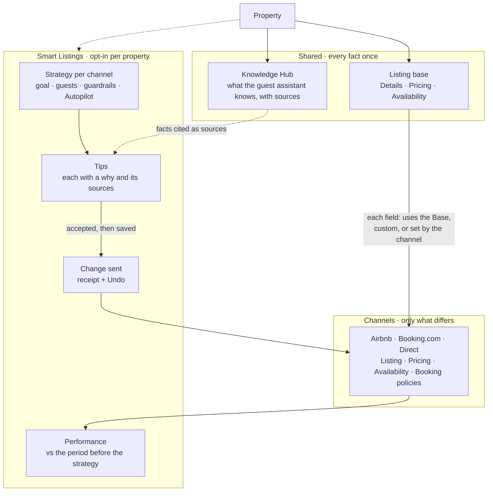

<callout icon="✅" color="gray_bg">
	**Output · Done** · The objects Smart Listings is built on, and how they relate. Provenance: `REAL·PRODUCT` (the live prototype); the channel rules behind it are `REAL·PUBLIC`.
</callout>
## The short version
- A **property** keeps its facts once, in **Shared**: the **Listing base** (the Details, Pricing and Availability every channel lists) and the **Knowledge Hub** (what the guest assistant knows, with its sources).
- Each **channel listing** (Airbnb, Booking⁠.com, Direct) starts from the Base and holds only what differs.
- Every field on a channel page is in one of three states: it **uses the Base**, it is **custom for that channel**, or it is **set by the channel**.
- **Smart Listings** adds a **strategy per channel**. The strategy produces **tips**, each with its why and sources. An accepted tip becomes a change that is sent with a receipt and Undo.
## The model

Booking policies have no Base: cancellation terms are each channel's own.
## Three states for every channel field
<table header-row="true">
<tr>
<td>State</td>
<td>What the channel page shows</td>
<td>Example in the prototype</td>
</tr>
<tr>
<td>**Uses the Base**</td>
<td>The Base value, read-only, with "Customize for Airbnb" to give this channel its own</td>
<td>Airbnb › Property name</td>
</tr>
<tr>
<td>**Custom for the channel**</td>
<td>The channel's own value, with "Use the Base" to go back</td>
<td>Booking⁠.com › Property name: "Artist Apartment Neukölln · Balcony & Fast Wi-Fi"</td>
</tr>
<tr>
<td>**Set by the channel**</td>
<td>Read-only, with the reason ("Booking⁠.com decides")</td>
<td>Booking⁠.com › Summary: Booking⁠.com writes its own description from the facts</td>
</tr>
</table>
Two edge cases follow the same rule. A value that must match everywhere says **All channels** and is edited once for every channel (check-in time, Wi-Fi name). A field only one channel has says **Airbnb only** (check-in method, checkout tasks, the short-stay cleaning fee).
 › Listing in the prototype. Photos and the property name are custom for [Booking.com](http://Booking.com); the summary is locked because [Booking.com](http://Booking.com) decides it. Sample data SIMULATED.](https://prod-files-secure.s3.us-west-2.amazonaws.com/8b3ff55d-72c7-4307-9089-beb3df02707e/1cdb2b6b-6a8a-434f-95e1-4a5dbf97b74e/ia-ch-booking.png#notion_record=block.88fb846f-2f84-4749-a2e3-ecb07edb95d2.8b3ff55d-72c7-4307-9089-beb3df02707e)
## What Smart Listings adds
- **Strategy:** one per channel, or one shared by several. It holds a goal, who to attract, guardrails (a price range and what always asks first) and Autopilot on or off.
- **Tip:** a proposed value for one field on one channel. Its why cites Knowledge Hub facts, guest inquiries and similar homes. The host accepts or dismisses it, or generates alternatives.
- **Change:** saved, then sent to the channel with a receipt (Sent, then Live, or In review on Booking⁠.com). A change from an accepted tip can also be undone.
- **Performance:** per channel, against the same number of days before the strategy started.
## What changed on the way
- The IA work merged Details into the Knowledge Hub as one record named for the home. The build keeps two named Shared sections: Listing base and Knowledge Hub.
- The earlier model kept a version of every send. The build drops versions; Performance compares with the period before the strategy, and receipts, plus Undo on an accepted tip, are the safety net.
- An earlier spec let hosts write a Booking⁠.com description. The build follows the channel: Booking⁠.com writes it, so the field is set by the channel.
## How it was made
Built up from the product audit (how Details, the Knowledge Hub and "Edit per channel" work today) and the channel scan (what each channel lets a host change), then cut down in design review to the objects a host actually sees. → <mention-page url="https://app.notion.com/p/3eee18af16458140b622c2f52f500edf"/> · <mention-page url="https://app.notion.com/p/3eee18af164581459cf4cb6d1a03f1d9"/>
---
**Builds on** · <mention-page url="https://app.notion.com/p/3eee18af16458163b059f704859d3a6a"/> · <mention-page url="https://app.notion.com/p/3eee18af1645818c859bcd3115fce28e"/> · <mention-page url="https://app.notion.com/p/3eee18af1645818094e8d80d9ddf2acd"/>
**Feeds** · <mention-page url="https://app.notion.com/p/3eee18af16458180a645fc510d470034"/> · <mention-page url="https://app.notion.com/p/3eee18af164581d6b4e2c132983137ce"/> · <mention-page url="https://app.notion.com/p/3eee18af164581178debffa0628f4703"/>
**Decisions** · <mention-page url="https://app.notion.com/p/3eee18af1645813ab697f55d6d253754"/> · <mention-page url="https://app.notion.com/p/3eee18af16458164b971f07e49e0fa84"/> · <mention-page url="https://app.notion.com/p/3eee18af164581b19c66d8d053ea6ab0"/> · <mention-page url="https://app.notion.com/p/3eee18af1645819d96d4cff8530e1600"/>
**In the prototype** · [Booking.com › Listing](https://hospitable-case-djur32.vercel.app/property/neukolln/ch/booking/listing) · <mention-page url="https://app.notion.com/p/3eee18af164581178debffa0628f4703"/> · <mention-page url="https://app.notion.com/p/3eee18af1645811f8fcfcbffc7cbb69d"/>
**Files** · `prototype/src/data/sl3.ts` (field states) · `prototype/src/ds/sl3.tsx` · `ia/object-model.md` · `ia/canonical-fields.md`
