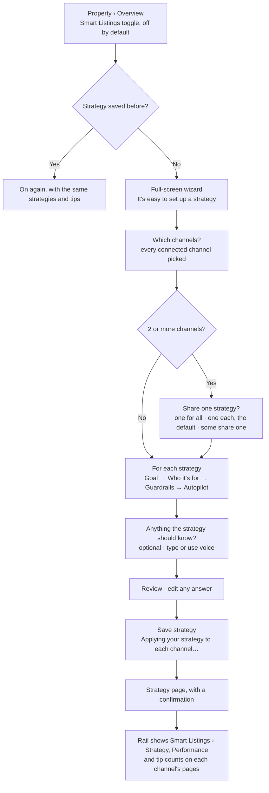
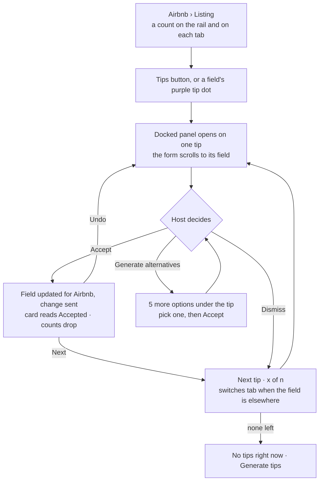
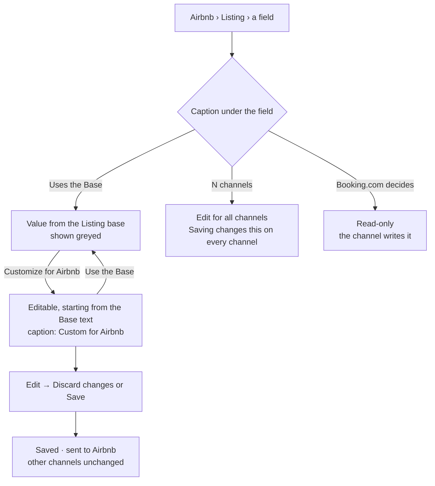
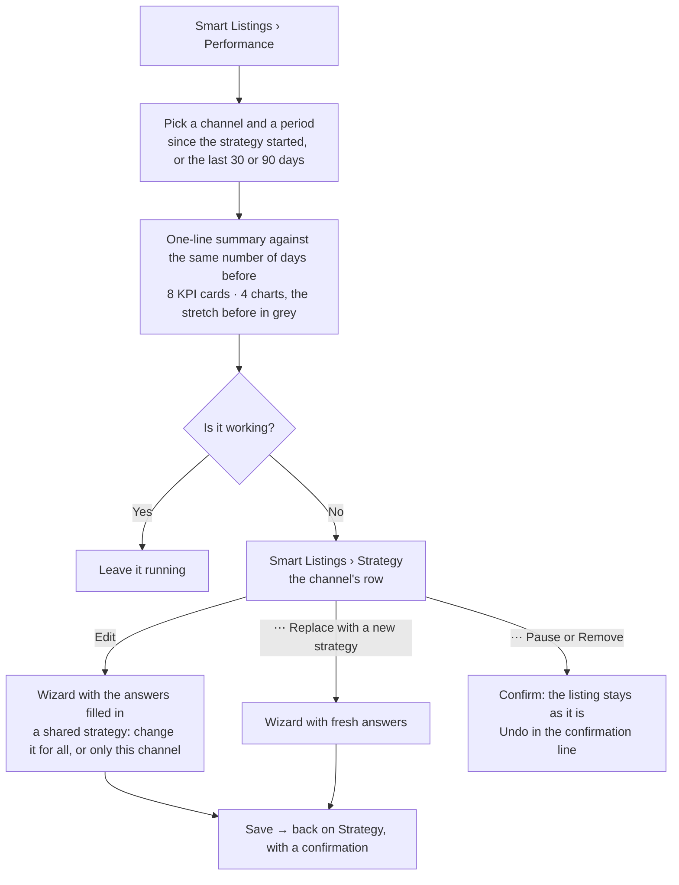
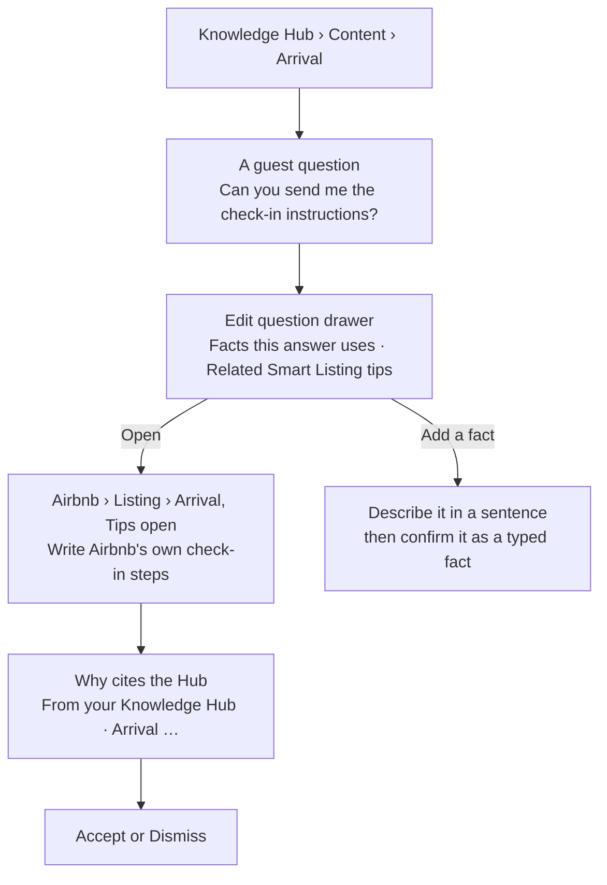

<callout icon="✅" color="gray_bg">
	**Output · Done** · The five key flows of Smart Listings, as the working prototype runs them. Each was checked by clicking through the live site or reading its code. Provenance: prototype behaviour; the sample content in it is `SIMULATED`.
</callout>
## The short version
- **Turn on:** one toggle on the Overview, then a full-screen wizard; tips appear on each channel's pages.
- **Work through tips:** one docked panel, one tip at a time. Accept sends the change, and Undo takes it back.
- **One field, one channel:** a field uses the Base until you customise it for a channel; switching back never loses work.
- **Did it work:** Performance compares each channel with the same stretch before its strategy; Strategy is where you edit or replace it.
- **Knowledge Hub to tips:** a guest question in the Hub links to the tips that use its facts, and those tips cite the Hub as a source.
## 1 · Turn on Smart Listings

**Why this shape:** Smart Listings is opt-in because not every host wants it, and the wizard copies Hospitable's own Add-property flow, which hosts already know. Closing the wizard with answers in it asks "Discard this strategy?" and nothing changes on the listings. <mention-page url="https://app.notion.com/p/3eee18af1645819d96d4cff8530e1600"/> · <mention-page url="https://app.notion.com/p/3eee18af164581028d64c3d0ff9f7d48"/>
## 2 · Work through tips on an Airbnb listing

**Why this shape:** one panel and one tip at a time keep the decision next to the field it changes, with its reason in view, and nothing changes until the host accepts. Undo withdraws the change it sent. <mention-page url="https://app.notion.com/p/3eee18af164581319e3afd8d876c7cb2"/> · <mention-page url="https://app.notion.com/p/3eee18af164581a693f6c6cc544b8c1a"/>
## 3 · Customise one field for one channel, or use the Base

**Why this shape:** a fact lives once and a channel holds only what differs. "Use the Base" keeps the custom text, so "Customize" brings it back. Hovering the caption shows the value behind the field on each channel. <mention-page url="https://app.notion.com/p/3eee18af1645813ab697f55d6d253754"/> · <mention-page url="https://app.notion.com/p/3eee18af16458164b971f07e49e0fa84"/>
## 4 · Check Performance, then edit or replace a strategy

**Why this shape:** there are no versions to learn. One built-in baseline answers "did this strategy work?", and every change to a strategy goes through the same wizard. <mention-page url="https://app.notion.com/p/3eee18af1645812290f5e2113a9a0844"/> · <mention-page url="https://app.notion.com/p/3eee18af164581028d64c3d0ff9f7d48"/>
## 5 · From a Knowledge Hub question to the tip that uses it

**Why this shape:** the Knowledge Hub feeds the tips, so the link shows in both directions: the Hub lists the open tips that use a question's facts, and each tip names the Hub fact behind it. In the prototype a newly added fact does not generate a new tip; the tips are scripted sample data. <mention-page url="https://app.notion.com/p/3eee18af164581b19c66d8d053ea6ab0"/> · <mention-page url="https://app.notion.com/p/3eee18af1645814fa326e55e940a5942"/>
## How it was made
Each flow was walked in the live prototype, or read from its code where a state is hard to reach by clicking. Flow 5 was checked by opening every question in Arrival, Amenities and Rules and reading its related tips.
---
**Builds on** · <mention-page url="https://app.notion.com/p/3eee18af164581d6b4e2c132983137ce"/> · <mention-page url="https://app.notion.com/p/3eee18af164581bdb0f8dd25c3d311a4"/>
**Feeds** · <mention-page url="https://app.notion.com/p/3eee18af164581b1958cc8edfcf3dcfe"/> (the tasks a host test would run)
**Decisions** · <mention-page url="https://app.notion.com/p/3eee18af1645819d96d4cff8530e1600"/> · <mention-page url="https://app.notion.com/p/3eee18af164581028d64c3d0ff9f7d48"/> · <mention-page url="https://app.notion.com/p/3eee18af1645812290f5e2113a9a0844"/> · <mention-page url="https://app.notion.com/p/3eee18af164581319e3afd8d876c7cb2"/> · <mention-page url="https://app.notion.com/p/3eee18af164581b19c66d8d053ea6ab0"/> · <mention-page url="https://app.notion.com/p/3eee18af164581a693f6c6cc544b8c1a"/>
**In the prototype** · [Overview](https://hospitable-case-djur32.vercel.app/property/neukolln/overview) · [Airbnb listing](https://hospitable-case-djur32.vercel.app/property/neukolln/ch/airbnb/listing/essentials?smart=on&autopilot=0) · [Performance](https://hospitable-case-djur32.vercel.app/property/neukolln/smart/performance?smart=on) · [Knowledge Hub › Arrival](https://hospitable-case-djur32.vercel.app/property/neukolln/hub/arrival?smart=on)
**Files** · `prototype/src/screens/smart/StrategyWizard.tsx` · `prototype/src/shell/ChannelTips.tsx` · `prototype/src/screens/channel/common.tsx` · `prototype/src/screens/smart/Performance.tsx` · `prototype/src/screens/hub/variants/R/model.ts`
