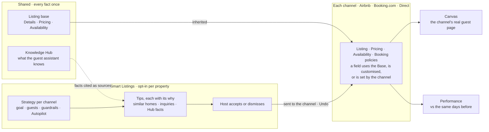

<callout icon="✅" color="gray_bg">
	**Output · Done** · Smart Listings as built, on one page: what it is, how a host uses it and what it answers. The working prototype is the source of truth. Provenance: the UI replicates Hospitable (`REAL·PRODUCT`); the sample listing, tips and numbers in it are `SIMULATED`.
</callout>

## The solution in one paragraph
Smart Listings makes Hospitable's listing management per channel without repeating work. Every fact about the home lives once, in **Shared**: the **Listing base** (the Details, Pricing and Availability every channel lists) and the **Knowledge Hub** (what the guest assistant knows). Each **channel** (Airbnb, Booking⁠.com, Direct) has its own Listing, Pricing, Availability and Booking policies pages. On them a field **uses the Base**, is **customised for that channel**, or is **set by the channel**: Booking⁠.com writes its own description, so it is read-only. **Smart Listings** is opt-in per property. A **strategy per channel** (goal, guests, guardrails, Autopilot on or off), made in a full-screen wizard, produces **tips** in one docked panel on that channel's pages. Each tip carries its *why* and its sources: similar homes, guest inquiries, Knowledge Hub facts. The host accepts or dismisses each one, or uses **Rewrite with AI** on a field that has no tip. A **Canvas** shows each channel's real guest page and opens the field you tap. **Performance** shows whether the strategy worked, against the same number of days before it started. Save is the commit: each change goes to its channel, and an accepted tip can be undone.
## The model

Diagram of the model as built in the prototype. Source: `prototype/src/shell/PropertyLayout.tsx`, `data/sl3.ts`, `shell/ChannelTips.tsx`.
## How a host uses it
1. **Turn it on.** On the property Overview, the Smart Listings toggle opens a full-screen strategy wizard. Turning it off later asks first and keeps everything. See <mention-page url="https://app.notion.com/p/3eee18af1645816c86aee6acef674975"/>.
2. **Set a strategy per channel.** A goal, the guests to attract, guardrails (a price range and what always asks first) and Autopilot on or off. One strategy can cover several channels, or each channel gets its own. Same page.
3. **Work through the tips.** Each channel's pages show how many tips wait. Tips opens one docked panel, one tip at a time, with its why. Accept, Dismiss or Generate alternatives; on a field without a tip, Rewrite with AI. See <mention-page url="https://app.notion.com/p/3eee18af1645811a82c4e772997ac875"/>.
4. **Change a fact once, or for one channel.** Every field says whether it uses the Base, is custom for this channel or is set by the channel, with one link to switch. Facts the guest assistant uses live in the Knowledge Hub and show up as tip sources. See <mention-page url="https://app.notion.com/p/3eee18af164581178debffa0628f4703"/> and <mention-page url="https://app.notion.com/p/3eee18af1645811f8fcfcbffc7cbb69d"/>.
5. **See it as guests do, and see if it worked.** Canvas shows each channel's page as its guests see it, and opens the field you tap. Performance compares each channel with the stretch before its strategy. See <mention-page url="https://app.notion.com/p/3eee18af16458187b60ec60bb6c3c5c5"/> and <mention-page url="https://app.notion.com/p/3eee18af1645818496f9d13c2481a86d"/>.
## What it answers from research
<table fit-page-width="true" header-row="true">
<tr>
<td>What I learned</td>
<td>Source</td>
<td>Design answer</td>
</tr>
<tr>
<td>Two stores of facts already disagree (Details and the Knowledge Hub), and no screen shows one listing on one channel.</td>
<td>`REAL·PRODUCT` · <mention-page url="https://app.notion.com/p/3eee18af16458163b059f704859d3a6a"/></td>
<td>Facts live once, in Shared. Each channel holds only what differs, behind a channel-first menu, and Canvas shows the channel's real guest page.</td>
</tr>
<tr>
<td>Hosts keep money and stay rules different per channel, much more than words.</td>
<td>`SIMULATED` · <mention-page url="https://app.notion.com/p/3eee18af1645818094e8d80d9ddf2acd"/></td>
<td>Tips cover Pricing, Availability and Booking policies, not only copy. Per-channel text is a choice ("Customize for Airbnb"), not a default.</td>
</tr>
<tr>
<td>Booking⁠.com writes its own description; there, a host's voice is how complete their facts are.</td>
<td>`REAL·PUBLIC` · <mention-page url="https://app.notion.com/p/3eee18af1645818c859bcd3115fce28e"/> · `SIMULATED` · <mention-page url="https://app.notion.com/p/3eee18af1645818094e8d80d9ddf2acd"/></td>
<td>Booking⁠.com's description is set by the channel and read-only. Booking⁠.com tips add facts instead, such as directions and self check-in.</td>
</tr>
<tr>
<td>Explaining a suggestion makes hosts accept it, and "where it goes" earns the most trust.</td>
<td>`SIMULATED` · <mention-page url="https://app.notion.com/p/3eee18af1645818094e8d80d9ddf2acd"/></td>
<td>Every tip shows its why, each reason with its source, and its scope ("Creates Airbnb's own value", "Applies to every channel"). Every field shows a scope caption.</td>
</tr>
<tr>
<td>Hosts new to this kind of tool risk trusting the AI too much.</td>
<td>`SIMULATED` · <mention-page url="https://app.notion.com/p/3eee18af1645818094e8d80d9ddf2acd"/></td>
<td>Guardrails: prices, stay rules and cancellation always ask first. Autopilot is off by default. An accepted tip can be undone.</td>
</tr>
</table>
Research rows marked `SIMULATED` come from illustrative research, not from real hosts. They are hypotheses for <mention-page url="https://app.notion.com/p/3eee18af164581b1958cc8edfcf3dcfe"/>.
## Try it
- **Website:** [hospitable-case-djur32.vercel.app](https://hospitable-case-djur32.vercel.app). It opens on the sample property's Overview.
- **Phone app:** [hospitable-case-mobile-djur32.vercel.app](https://hospitable-case-mobile-djur32.vercel.app). The same prototype at phone size; see <mention-page url="https://app.notion.com/p/3eee18af164581daa8b7f210cb1c6f4e"/>.
- The sample property is "Beautiful Artist Apt. in Neukölln" on Airbnb, Booking⁠.com and Direct. Its listing, tips, inquiries and performance figures are `SIMULATED`.
## How it was made
Built in code on Hospitable's own design tokens, replicating its UI and departing only where the model needs it. Shaped through rounds of my own design review. See <mention-page url="https://app.notion.com/p/3eee18af1645811087cecfef47d6bfe3"/> and <mention-page url="https://app.notion.com/p/3eee18af1645814fbc15f0a668dc4632"/>.
---
**Builds on** · <mention-page url="https://app.notion.com/p/3eee18af164581bdb0f8dd25c3d311a4"/> · <mention-page url="https://app.notion.com/p/3eee18af16458168b8ede129bf1dc3a9"/> · <mention-page url="https://app.notion.com/p/3eee18af1645818094e8d80d9ddf2acd"/>
**Feeds** · <mention-page url="https://app.notion.com/p/3eee18af164581b1958cc8edfcf3dcfe"/> · <mention-page url="https://app.notion.com/p/3eee18af1645813d9391e336e308e3d7"/>
**Decisions** · <mention-page url="https://app.notion.com/p/3eee18af1645813ab697f55d6d253754"/> · <mention-page url="https://app.notion.com/p/3eee18af164581f59e84e075de884cde"/> · <mention-page url="https://app.notion.com/p/3eee18af1645819d96d4cff8530e1600"/> · <mention-page url="https://app.notion.com/p/3eee18af164581319e3afd8d876c7cb2"/> · <mention-page url="https://app.notion.com/p/3eee18af164581ca9016ce7928ea3008"/>
**In the prototype** · [Airbnb listing with Tips](https://hospitable-case-djur32.vercel.app/property/neukolln/ch/airbnb/listing/essentials?smart=on&autopilot=0&tip=t-a-name)
**Files** · `prototype/src/routes.tsx` · `prototype/src/shell/PropertyLayout.tsx` · `prototype/src/data/sl3.ts` · `plan/notion-v2/shots/sl-hero.png`
